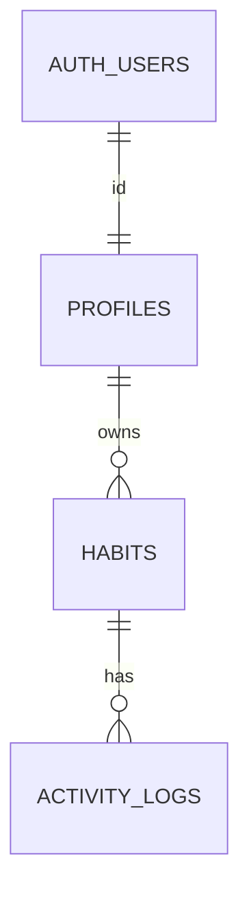
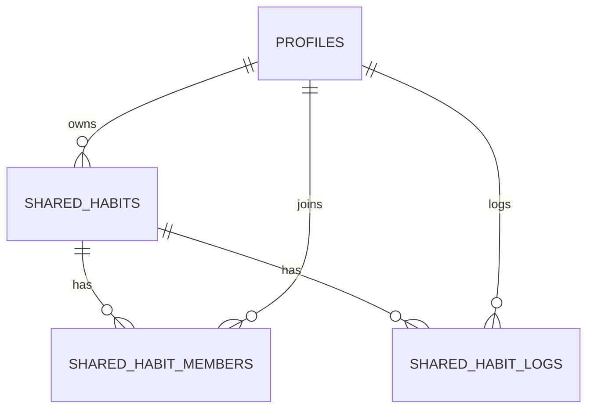

# Habit Garden: Database Design

What the database stores, who can read and change it, and how changes are recorded. For the backend that uses it, see [the backend design](../backend/design.md). For the big picture, see [design.md](../design.md).

---

## Contents

- [1. Overview](#1-overview)
- [2. Tables](#2-tables)
- [3. Access control](#3-access-control)
- [4. Functions and triggers](#4-functions-and-triggers)
- [5. Migrations](#5-migrations)
- [6. Decisions](#6-decisions)
- [7. Open items](#7-open-items)
- [8. Shared habits (planned)](#8-shared-habits-planned)

---

## 1. Overview

- **Supabase Postgres**, with Supabase Auth for sign-in (Google).
- **Three tables** for personal habits: `profiles`, `habits`, `activity_logs`. Shared habits add three more tables, which are planned and described in [section 8](#8-shared-habits-planned).
- **Store facts, compute stats.** Progress, streaks, health, growth and badges are not stored. The backend calculates them from habits and logs.
- **Row Level Security (RLS) is on for every table.** The backend uses the signed-in user's token, so RLS applies to it as well. It is a safety net behind the backend's own checks.

Deleting a user cascades: the profile, their habits and those habits' logs all go.

---

## 2. Tables

### 2.1 profiles

One row per user, created by a trigger on first sign-in.

| Column | Type | Notes |
| --- | --- | --- |
| `id` | uuid | Primary key. References `auth.users(id)`, on delete cascade |
| `display_name` | text | Required, 1 to 50 characters |
| `avatar_url` | text | Optional |
| `created_at` | timestamptz | Defaults to now |
| `timezone` | text | Optional IANA name, such as `America/Los_Angeles`. Validated by a trigger. Unset means the backend uses UTC |

The email stays in `auth.users` and is not copied here.

### 2.2 habits

One row per habit.

| Column | Type | Notes |
| --- | --- | --- |
| `id` | uuid | Primary key |
| `owner_id` | uuid | References `profiles(id)`, on delete cascade. Defaults to the signed-in user |
| `name` | text | Required, 1 to 100 characters after trimming |
| `description` | text | Optional, up to 500 characters |
| `plant_type` | text | Required. No database check on the values. The backend validates them |
| `target_count` | int | 1 to 50 |
| `interval_count` | int | 1 to 365 |
| `interval_unit` | text | `day`, `week` or `month` |
| `num_periods` | int | 1 to 52. Nullable, so indefinite habits can be added later |
| `start_date` | date | Required |
| `created_at` | timestamptz | Defaults to now |

- There is **no `end_date` column.** The end date is computed from the start date, interval and number of periods.
- There is **no `timezone` column.** The timezone belongs to the profile.
- The goal columns (`target_count` to `start_date`) will be locked after creation (#104). See section 3.2.

### 2.3 activity_logs

One row per logged activity. Rows are added or deleted, never updated.

| Column | Type | Notes |
| --- | --- | --- |
| `id` | uuid | Primary key |
| `habit_id` | uuid | References `habits(id)`, on delete cascade |
| `occurred_on` | date | The local date the activity happened, in the user's timezone |
| `created_at` | timestamptz | Defaults to now |

- An index on `(habit_id, occurred_on)` speeds up period counts.
- There is no `user_id`. The owner is the habit's `owner_id`.
- Several logs on the same day are allowed.

---

## 3. Access control

### 3.1 Row policies

| Table | Read | Insert | Update | Delete |
| --- | --- | --- | --- | --- |
| `profiles` | Your own row | Trigger only | Your own row | Through account deletion only |
| `habits` | Your own | As yourself (`owner_id` is you) | Your own | Your own |
| `activity_logs` | Logs of your habits | Logs of your habits | No one | Logs of your habits |

The "current period only" rule for logs is **not** in the database. The backend enforces it. The policies for the planned shared habit tables are in [section 8.3](#83-row-level-security).

### 3.2 Column grants

RLS can't restrict which columns change, so column-level grants do it. A grant is an allow-list: anything not granted is locked, including columns added later.

| Table | Users can update | Status |
| --- | --- | --- |
| `profiles` | `display_name`, `avatar_url`, `timezone` | Live |
| `habits` | Nothing. A habit cannot be edited, only created and deleted | Planned (`20261111_01_lock_all_habit_columns.sql`). #104 had allowed `name`, `description` and `plant_type` |
| `activity_logs` | Nothing. Revoke `update`, but never revoke `delete` | Planned (#104) |

Re-run the revokes whenever a new table is added.

---

## 4. Functions and triggers

| Name | What it does |
| --- | --- |
| `handle_new_user()` and trigger `on_auth_user_created` | Creates the profile row when a user signs up. `security definer`, because `profiles` has no insert policy. Name falls back from full name, to name, to the email prefix, to `user` |
| `delete_my_account()` | Deletes the calling user from `auth.users`, which cascades to everything they own. Takes no id, so it can only delete the caller. Only `authenticated` can run it |
| `validate_profile_timezone()` and trigger `validate_profile_timezone_trigger` | Rejects a timezone that is not in `pg_timezone_names` |

`security definer` means a function runs with its owner's permissions, so it can do what the caller cannot. Always pair it with a fixed `search_path`.

The planned functions for shared habits are in [section 8.4](#84-functions-and-triggers).

---

## 5. Migrations

- **Every piece of SQL run on Supabase is saved in `supabase/migrations/`.** Tables, policies, grants, triggers and functions. The repo shows what the database does.
- Run the SQL in the Supabase SQL Editor and commit the same file in a PR. The Supabase CLI is not used.
- Files named `<date>_<number>_<name>.sql` run in order. `20261104_01_initial_schema.sql` is a snapshot of the first schema and should not be re-run on the live database. `20261104_02_profile_timezone.sql` adds the profile timezone and drops `habits.timezone` and `end_date`. `user_signup_deletion_functions.sql` is older and has no date prefix.
- Write new migrations so they can be re-run: `if not exists`, `drop ... if exists`, `create or replace`. Some existing ones are not fully re-runnable, so do not run them twice.
- `user_signup_deletion_functions.sql` is the source of truth for `handle_new_user` and `delete_my_account`. The copy of `handle_new_user` in the initial snapshot is older.
- Test policy and grant changes with two throwaway users. Never use real teammate accounts.

---

## 6. Decisions

| Decision | Why |
| --- | --- |
| Shared habits are separate tables, not a flag on `habits` (planned) | Personal habits, their policies and the code already built stay untouched |
| Shared habit logs have no foreign key to the members table (planned) | Leaving removes the membership but keeps past logs, and a cascade would delete them |
| Shared habit access goes through `security definer` functions (planned) | Everything runs as the signed-in user with no admin key, so a non-member cannot join or read other members' data any other way |
| Table is `profiles`, not `users` | Avoids confusion with `auth.users` |
| Profile row is created by a trigger, not an insert policy | Works for every sign-in method with no frontend code |
| No `habits` column can be updated, enforced with column grants | Accountability comes before flexibility: a habit is a commitment. RLS can't restrict columns, and a grant is an allow-list |
| Habits are hard deleted, with a confirmation | Badges and streaks are computed, so nothing stored is lost |
| Email is not copied to `profiles` | A copy goes stale and could leak |
| One timezone per user, on the profile | The server needs it to know what "today" is |
| Delete account is a database function | No admin key is needed |
| `num_periods` is nullable | Groundwork for indefinite habits |

---

## 7. Open items

- Column grants for `habits` and `activity_logs` (#104).
- What happens to existing `occurred_on` dates if a user changes their timezone.
- The shared habit questions in [section 8.7](#87-open-items).

---

## 8. Shared habits (planned)

A design that has not been built or run on Supabase yet. For what a shared habit is, see [design.md](../design.md#5-shared-habits-planned). For the rules behind the group numbers, see [the backend design](../backend/design.md#66-shared-habits-planned).

### 8.1 Why functions are needed

Everything runs as the signed-in user with RLS on, and there is no admin key. That has four consequences:

- **Joining.** A person who is not a member yet cannot read the habit, so they cannot look it up by its code or add themselves. Both need a `security definer` function.
- **Other members' data.** Under RLS a user reads only their own logs and profile. The backend needs the other members' log dates to calculate their progress, and their display names, so functions return only those columns, and only to members.
- **Recursion.** A policy on `shared_habit_members` that reads `shared_habit_members` fails with "infinite recursion". A small `security definer` helper, `is_shared_habit_member`, breaks the loop. Every policy that asks whether a user is a member uses it.
- **Ownership.** `owner_id` is never updated directly, or an owner could hand a habit to anyone. A function does the transfer.

Every function sets a fixed `search_path`, is revoked from `public` and `anon`, and is granted to `authenticated` only, as `delete_my_account` is.

### 8.2 Tables

The goal columns copy `habits`, with the same limits, so the backend's calculation code can read a shared habit as it is.

#### shared_habits

| Column | Type | Notes |
| --- | --- | --- |
| `id` | uuid | Primary key |
| `owner_id` | uuid | References `profiles(id)`, **on delete restrict**, so an owner is never lost silently (section 8.5). Defaults to the signed-in user |
| `name` | text | Required, 1 to 100 characters after trimming |
| `description` | text | Optional, up to 500 characters |
| `plant_type` | text | Required. No database check on the values. The backend validates them |
| `target_count` | int | 1 to 50 |
| `interval_count` | int | 1 to 365 |
| `interval_unit` | text | `day`, `week` or `month` |
| `num_periods` | int | 1 to 52, **not null**. A shared habit always has an end |
| `start_date` | date | Required |
| `join_by` | date | Required. Must be on or before `start_date` |
| `max_members` | int | Required. At least 2 and at most the system maximum (proposed 50) |
| `join_code` | text | Unique. Defaults to 32 random characters. **Null means joining is closed.** The owner regenerates it by setting a new value |
| `created_at` | timestamptz | Defaults to now |

- The backend checks that `start_date` is today or later and that `join_by` is not in the past, as it does for a personal habit's start date.
- Indexes: the unique one on `join_code`, and one on `owner_id`.

#### shared_habit_members

| Column | Type | Notes |
| --- | --- | --- |
| `shared_habit_id` | uuid | References `shared_habits(id)`, on delete cascade |
| `user_id` | uuid | References `profiles(id)`, on delete cascade |
| `joined_at` | timestamptz | Defaults to now |
| `timezone` | text | Required. A copy of the member's profile timezone (UTC when it is unset), taken when they join. It never follows later profile changes, so the group's lock cannot move |

- The primary key is `(shared_habit_id, user_id)`, so nobody joins twice.
- The owner has a row too, created by a trigger.
- An index on `user_id` lists a user's shared habits.
- Leaving deletes the row. The member's logs are kept.

#### shared_habit_logs

| Column | Type | Notes |
| --- | --- | --- |
| `id` | uuid | Primary key |
| `shared_habit_id` | uuid | References `shared_habits(id)`, on delete cascade |
| `user_id` | uuid | Required. References `profiles(id)`, on delete cascade. Defaults to the signed-in user |
| `occurred_on` | date | The member's local date, as in `activity_logs` |
| `created_at` | timestamptz | Defaults to now |

- An index on `(shared_habit_id, user_id, occurred_on)` speeds up period counts.
- There is deliberately **no foreign key to the members table**, so leaving keeps the past logs.
- Rows are added or deleted, never updated.

### 8.3 Row level security

RLS is on for all three tables, and `anon` gets nothing. "Member" below means `is_shared_habit_member(shared_habit_id)` is true.

| Table | Read | Insert | Update | Delete |
| --- | --- | --- | --- | --- |
| `shared_habits` | Members | As yourself (`owner_id` is you) | The owner, on allowed columns only | The owner |
| `shared_habit_members` | Members of the same habit | No one. Only the join function and the owner trigger | No one | Yourself if you are not the owner (leaving), or the owner removing someone else |
| `shared_habit_logs` | Your own logs | As yourself, and only if you are a member | No one | Your own logs |

Column grants:

| Table | Users can update |
| --- | --- |
| `shared_habits` | `name`, `description`, `plant_type`, `target_count`, `interval_count`, `interval_unit`, `num_periods`, `start_date`, `join_by`, `max_members`, `join_code`. Never `id` or `owner_id` |
| `shared_habit_members` | Nothing |
| `shared_habit_logs` | Nothing. Revoke `update`, but never revoke `delete` |

Whether a column may change right now (while the owner is alone, once someone has joined, or after the start) depends on state, so it is not a column grant. The backend enforces it.

### 8.4 Functions and triggers

| Name | Who can call it | What it does |
| --- | --- | --- |
| `is_shared_habit_member(shared_habit_id)` | Authenticated | Returns true when the caller has a member row. `stable`. Used by the policies |
| `shared_habit_preview(code)` | Authenticated | For the join screen. If the code is valid and joining is open, returns the name, description, plant type, goal, dates, the owner's display name, the member count and `max_members`. Otherwise returns nothing, and never says why |
| `join_shared_habit(code)` | Authenticated | Locks the habit row, then checks that the code matches and is not null, the caller is not already a member (if so, it returns the id and does nothing), the caller's **own local date** is on or before `join_by`, and the member count is below `max_members`. Then inserts the member row with the timezone copy and returns the habit id. Raises a named error for each failure |
| `shared_habit_members_info(shared_habit_id)` | Members | Returns `user_id`, `display_name`, `avatar_url`, `joined_at`, `timezone` and `is_owner` for the current members |
| `shared_habit_member_logs(shared_habit_id)` | Members | Returns `(user_id, occurred_on, count)` per day, only for current members. It counts per day, not one row per log, to keep the result small. It can still exceed the API's row limit (1000 by default), so the backend pages through it |
| `transfer_shared_habit_ownership(shared_habit_id, new_owner)` | The owner | The new owner must be a member. Sets `owner_id` |
| Trigger `add_shared_habit_owner` | Runs after an insert on `shared_habits` | Inserts the owner's member row with their timezone copy. `security definer`, because the members table has no insert policy |
| Trigger `check_member_cap` | Runs before an insert on the members table | A backstop. Locks the habit row and refuses an insert past `max_members`. On `shared_habits` it refuses a `max_members` below the current member count |

The join errors have stable messages so the backend can map them: not found or closed (404), full (409), joining ended (400).

### 8.5 Delete account

`delete_my_account()` deletes the user from `auth.users`, which cascades to everything they own. For shared habits that would delete a whole group's data when the owner leaves, so it first handles every shared habit the caller owns:

1. If another member exists, ownership goes to the one with the earliest `joined_at`.
2. If nobody else is in it, the habit is deleted.

Then the user is deleted as before. The `on delete restrict` on `owner_id` is a backstop: if a path skipped the step, the delete fails and nothing is lost. A member who deletes their account loses their own membership and logs, so the group's average changes, as when someone leaves.

### 8.6 Migration plan

One file per concern, named `<date>_<number>_<name>.sql` and written to be re-run:

1. The tables, indexes and checks.
2. RLS, policies and column grants, with `is_shared_habit_member`.
3. The functions and triggers.
4. The new `delete_my_account()`.

Test each with two or more throwaway users, as in section 5.

### 8.7 Open items

- Whether leaving deletes the member row (proposed) or keeps it with a `left_at` column, which a later "badges for everyone who finished" would need.
- Whether edit timing is also enforced by a trigger. Proposed: the backend only at first.
- The system maximum for `max_members` (proposed 50).
- Rate limiting wrong codes. Postgres cannot do it, so it belongs to the backend.
- The row limit on the member logs function, if a group's logs get large.