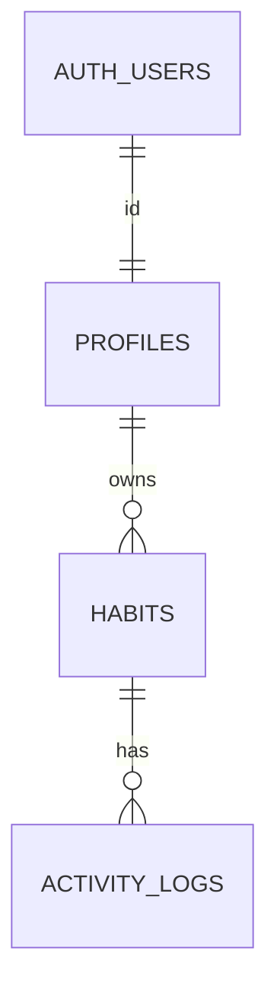

# Habit Garden: Database Design

What the database stores, who can read and change it, and how changes are recorded. For the backend that uses it, see [the backend design](../backend/design.md). For the big picture, see [design.md](../design.md).

---

## Contents

- [1. Overview](#1-overview)
- [2. Tables](#2-tables)
- [3. Access control](#3-access-control)
- [4. Functions and triggers](#4-functions-and-triggers)
- [5. Migrations](#5-migrations)
- [6. Decisions](#6-decisions)
- [7. Open items](#7-open-items)

---

## 1. Overview

- **Supabase Postgres**, with Supabase Auth for sign-in (Google).
- **Three tables:** `profiles`, `habits`, `activity_logs`. Personal habits only.
- **Store facts, compute stats.** Progress, streaks, health, growth and badges are not stored. The backend calculates them from habits and logs.
- **Row Level Security (RLS) is on for every table.** The backend uses the signed-in user's token, so RLS applies to it as well. It is a safety net behind the backend's own checks.

Deleting a user cascades: the profile, their habits and those habits' logs all go.

---

## 2. Tables

### 2.1 profiles

One row per user, created by a trigger on first sign-in.

| Column | Type | Notes |
| --- | --- | --- |
| `id` | uuid | Primary key. References `auth.users(id)`, on delete cascade |
| `display_name` | text | Required, 1 to 50 characters |
| `avatar_url` | text | Optional |
| `created_at` | timestamptz | Defaults to now |
| `timezone` | text | Optional IANA name, such as `America/Los_Angeles`. Validated by a trigger. Unset means the backend uses UTC |

The email stays in `auth.users` and is not copied here.

### 2.2 habits

One row per habit.

| Column | Type | Notes |
| --- | --- | --- |
| `id` | uuid | Primary key |
| `owner_id` | uuid | References `profiles(id)`, on delete cascade. Defaults to the signed-in user |
| `name` | text | Required, 1 to 100 characters after trimming |
| `description` | text | Optional, up to 500 characters |
| `plant_type` | text | Required. No database check on the values. The backend validates them |
| `target_count` | int | 1 to 50 |
| `interval_count` | int | 1 to 365 |
| `interval_unit` | text | `day`, `week` or `month` |
| `num_periods` | int | 1 to 52. Nullable, so indefinite habits can be added later |
| `start_date` | date | Required |
| `created_at` | timestamptz | Defaults to now |

- There is **no `end_date` column.** The end date is computed from the start date, interval and number of periods.
- There is **no `timezone` column.** The timezone belongs to the profile.
- The goal columns (`target_count` to `start_date`) will be locked after creation (#104). See section 3.2.

### 2.3 activity_logs

One row per logged activity. Rows are added or deleted, never updated.

| Column | Type | Notes |
| --- | --- | --- |
| `id` | uuid | Primary key |
| `habit_id` | uuid | References `habits(id)`, on delete cascade |
| `occurred_on` | date | The local date the activity happened, in the user's timezone |
| `created_at` | timestamptz | Defaults to now |

- An index on `(habit_id, occurred_on)` speeds up period counts.
- There is no `user_id`. The owner is the habit's `owner_id`.
- Several logs on the same day are allowed.

---

## 3. Access control

### 3.1 Row policies

| Table | Read | Insert | Update | Delete |
| --- | --- | --- | --- | --- |
| `profiles` | Your own row | Trigger only | Your own row | Through account deletion only |
| `habits` | Your own | As yourself (`owner_id` is you) | Your own | Your own |
| `activity_logs` | Logs of your habits | Logs of your habits | No one | Logs of your habits |

The "current period only" rule for logs is **not** in the database. The backend enforces it.

### 3.2 Column grants

RLS can't restrict which columns change, so column-level grants do it. A grant is an allow-list: anything not granted is locked, including columns added later.

| Table | Users can update | Status |
| --- | --- | --- |
| `profiles` | `display_name`, `avatar_url`, `timezone` | Live |
| `habits` | `name`, `description`, `plant_type` only | Planned (#104) |
| `activity_logs` | Nothing. Revoke `update`, but never revoke `delete` | Planned (#104) |

Re-run the revokes whenever a new table is added.

---

## 4. Functions and triggers

| Name | What it does |
| --- | --- |
| `handle_new_user()` and trigger `on_auth_user_created` | Creates the profile row when a user signs up. `security definer`, because `profiles` has no insert policy. Name falls back from full name, to name, to the email prefix, to `user` |
| `delete_my_account()` | Deletes the calling user from `auth.users`, which cascades to everything they own. Takes no id, so it can only delete the caller. Only `authenticated` can run it |
| `validate_profile_timezone()` and trigger `validate_profile_timezone_trigger` | Rejects a timezone that is not in `pg_timezone_names` |

`security definer` means a function runs with its owner's permissions, so it can do what the caller cannot. Always pair it with a fixed `search_path`.

---

## 5. Migrations

- **Every piece of SQL run on Supabase is saved in `supabase/migrations/`.** Tables, policies, grants, triggers and functions. The repo shows what the database does.
- Run the SQL in the Supabase SQL Editor and commit the same file in a PR. The Supabase CLI is not used.
- Files named `<date>_<number>_<name>.sql` run in order. `20261104_01_initial_schema.sql` is a snapshot of the first schema and should not be re-run on the live database. `20261104_02_profile_timezone.sql` adds the profile timezone and drops `habits.timezone` and `end_date`. `user_signup_deletion_functions.sql` is older and has no date prefix.
- Write new migrations so they can be re-run: `if not exists`, `drop ... if exists`, `create or replace`. Some existing ones are not fully re-runnable, so do not run them twice.
- `user_signup_deletion_functions.sql` is the source of truth for `handle_new_user` and `delete_my_account`. The copy of `handle_new_user` in the initial snapshot is older.
- Test policy and grant changes with two throwaway users. Never use real teammate accounts.

---

## 6. Decisions

| Decision | Why |
| --- | --- |
| Personal habits only. Groups are out of scope | Keeps the first version small |
| Table is `profiles`, not `users` | Avoids confusion with `auth.users` |
| Profile row is created by a trigger, not an insert policy | Works for every sign-in method with no frontend code |
| Goal columns are locked with column grants | RLS can't restrict columns, and a grant is an allow-list |
| Habits are hard deleted, with a confirmation | Badges and streaks are computed, so nothing stored is lost |
| Email is not copied to `profiles` | A copy goes stale and could leak |
| One timezone per user, on the profile | The server needs it to know what "today" is |
| Delete account is a database function | No admin key is needed |
| `num_periods` is nullable | Groundwork for indefinite habits |

---

## 7. Open items

- Column grants for `habits` and `activity_logs` (#104).
- What happens to existing `occurred_on` dates if a user changes their timezone.