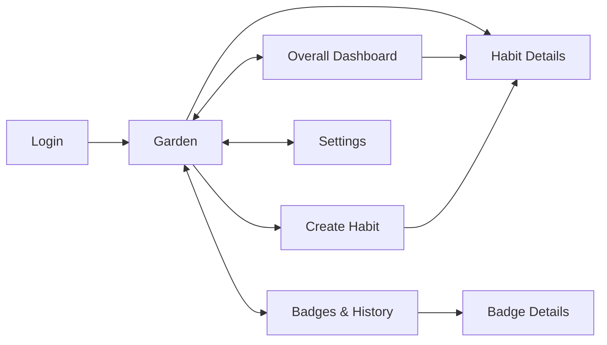

# Habit Garden: Design

Habit Garden is a habit tracker where every habit is a plant. Logging activities makes the plant grow; meeting recurring goals keeps it healthy. When a habit's duration ends, the user earns a badge based on how well they did.

This document describes the app's screens, the rules behind every number it shows, and how it is built. It is the source of truth for MVP behavior.

---

## Contents

- [1. Overview](#1-overview)
- [2. Architecture](#2-architecture)
- [3. Screens](#3-screens)
- [4. Behavior and calculation rules](#4-behavior-and-calculation-rules)
- [5. Out of scope for the MVP](#5-out-of-scope-for-the-mvp)
- [6. Open questions](#6-open-questions)

---

## 1. Overview

**Core idea.** A habit has a goal ("go to the gym 3 times every week for 4 weeks"). The user logs each time they do it.

- **Growth** comes from total progress toward the whole goal. Plants never shrink.
- **Health** comes from recent consistency: meeting the goal in each recurring period. Missing goals wilts the plant; meeting them again makes it recover.
- **Badges** (Bronze, Silver, Gold) are awarded when the habit ends.

**Habit types.**

- **Personal habits** belong to one user.
- **Group habits** (planned) share one goal and one plant across several users. Each member logs their own activity, and the shared plant reflects the group's average.

---

## 2. Architecture

| Layer | Technology | Responsibility |
| --- | --- | --- |
| Frontend | React (Vite), in `frontend/` | All screens; computes displayed stats from logs |
| Auth | Supabase Auth, Google OAuth | Sign-in and sessions |
| Database | Supabase Postgres, in `supabase/migrations/` | Stores profiles, habits, and activity logs |
| Access control | Postgres Row Level Security (RLS) | Users can only read and change their own data |
| Server logic | Supabase Edge Functions, in `supabase/functions/` | Logic that needs a verified user, e.g. `verify-user` |

**Design principles.**

- **Store facts, compute stats.** Only habits and activity logs are stored. Progress, consistency, streaks, health, growth, and badges are calculated from them whenever they're shown, so they can never go out of sync and no scheduled jobs are needed.
- **Enforce rules in the database.** The frontend can be bypassed, so access rules live in RLS policies, not just the UI.
- **Dates are local to the habit.** Each habit stores its timezone, and each log stores the local date it happened. Period boundaries fall at midnight in that timezone.

---

## 3. Screens

Every main screen links to the others through the navigation bar.

### 3.1 Login

- App name, logo, short description, and **Sign in with Google**.
- A profile is created automatically on first sign-in.
- After login, users land on the Garden (empty for new users).
- Every other page requires a session. Sessions persist across refreshes until logout or expiry.

### 3.2 Garden (home)

All active habits shown as potted plants in a grid.

- Each plant shows its **name**, a **current period progress bar**, and its **appearance** (growth stage + health).
- **Pot color/style** distinguishes personal from group habits.
- For group habits, the plant shows the shared group state, while the progress bar shows the user's own period progress.
- **Click** a plant to open Habit Details.
- **Press and hold** a plant to log an activity for today.
- Each plant's options menu: **Log activity**, **View details**, **Edit habit**.
- **Empty state:** an empty garden prompting the user to create their first habit.
- **Nav:** Overall Dashboard, Badges, Settings, Add Habit.

### 3.3 Overall Dashboard

A summary of activity across all active habits.

- **Active habits:** count of personal and group habits currently tracked.
- **Overall consistency:** average consistency across active habits ([rule 4.5](#45-overall-consistency)). Shows "—" if no habit has finished a period yet.
- **Habit list.** Each row shows:
  - Habit name and personal/group indicator
  - Current period progress (e.g., 2/3 this week)
  - Streak (e.g., 3 weeks)
  - Remaining duration
  - Mini calendar: green on days with logs, gray otherwise. Missed goals are shown per period, not per day.
- Clicking a habit opens Habit Details.
- **Nav:** My Garden, Badges, Settings.

### 3.4 Habit Details

**Info:** name, description, plant type, personal/group, goal (e.g., 3 times every week), start and end dates, remaining duration.

**Progress:**

| Metric | Shows | Rule |
| --- | --- | --- |
| Current period | Count toward target (e.g., 2/3), progress bar with tick marks | [4.2](#42-current-period-progress) |
| Overall progress | % of total target, capped at 100% (circular indicator) | [4.3](#43-overall-progress) |
| Consistency | % of completed periods where the target was met | [4.4](#44-consistency) |
| Current streak | Consecutive successful completed periods | [4.6](#46-streaks) |

**Activity history:** calendar of logged dates, plus a per-period breakdown with each completed period's count and whether its goal was met. Logs in the current period show a delete button.

**Plant:** growth stage ([4.7](#47-plant-growth)) combined with health ([4.8](#48-plant-health)).

**Actions:**

- **Log activity.** A date picker defaults to today and allows any date in the current period up to today.
- **Undo** toast for about 5 seconds after logging.
- **Delete a log** from the current period.
- **Edit habit:** name, description, and plant type only. Goal, period, and duration are locked after creation.
- **Delete habit** (with confirmation). Removes the habit and its logs.

**Group habits also show:** members; each member's progress, consistency, and streak; group progress; the shared plant; and Leave group / Manage members (owner only).

### 3.5 Create Habit

| Field | Details |
| --- | --- |
| Name | Required, 1–100 characters |
| Description | Optional, up to 500 characters |
| Goal | Target count per period (1–50) + recurring period: interval (≥ 1) and unit (days, weeks, or months). E.g., 3 times every 1 week. |
| Duration | Number of periods (1–52). Start date is the creation date; the calculated end date is shown. |
| Plant | Choose a plant type, with a preview. Plants start at stage 1. |
| Type | Personal or group. Group habits invite other users. |

- **Goal preview:** a sentence summarizing the setup, e.g., "Go to the gym 3 times every week for 4 weeks."
- **Validation errors** are shown inline. If saving fails, an error message is shown.
- **After creation:** redirect to the new habit's Details page. **Cancel** returns to the Garden.

### 3.6 Badges and Habit History

- **Badge grid:** at most one badge per habit. Each shows the habit name, plant illustration, level (Bronze/Silver/Gold), and completion date.
- **Badge details:** goal and duration, final overall progress and consistency, total activities, final plant stage and health, level, completion date.
- **Habit history:** all expired habits, including those without badges, with final stats and activity history.
- **Empty state:** encouragement to keep growing habits.
- **Nav:** Overall Dashboard, My Garden, Settings.

### 3.7 Settings

- Username, email, and profile picture (from Google). Display name is editable.
- Light/dark mode toggle, saved in the browser.
- Log out. Delete account (with confirmation).
- **Nav:** Overall Dashboard, My Garden, Badges.

---

## 4. Behavior and calculation rules

### 4.1 Periods and logging

- Each habit has a **target count**, a **recurring period** (interval + unit), a **number of periods**, a **start date**, and a **timezone** (the creator's, set at creation).
- **Start date** is the creation date. **End date** = start + (number of periods × interval).
- Period *k* covers **[start + k × interval, start + (k+1) × interval)**. Boundaries fall at midnight in the habit's timezone. Month periods are always counted from the original start date.
- Each log stores the **date the activity happened** (local date in the habit's timezone) and the **time it was logged** (server time).
- Users can log activities for any date in the **current period**, up to and including today. Future dates are not allowed.
- Users can delete their own logs in the current period. Logs are never edited; to fix one, delete it and add it again.
- A period **locks when it ends**. Locked periods are final and count toward consistency, streak, and health.

### 4.2 Current period progress

- Progress = logs this period ÷ target.
- The bar caps at 100%, but the count can exceed the target (e.g., 4/3).

### 4.3 Overall progress

- Total target = target count × number of periods.
- Overall progress = min(100%, total logs ÷ total target).
- Extra logs in one period make up for shortfalls in another.
- Determines plant growth.

**Example** (gym 3×/week for 4 weeks): 5 + 1 + 4 + 2 = 12 of 12 → **100%**.

### 4.4 Consistency

- Consistency = successful completed periods ÷ completed periods.
- A period is **successful** if its target was met.
- The current period is excluded. Extra logs in a later period can't fix an earlier one.

**Example:** 5/3 ✓, 1/3 ✗, 4/3 ✓, 2/3 ✗ → **50%**.

### 4.5 Overall consistency

- The average of each active habit's consistency, excluding habits with no completed periods.
- For group habits, the user's own consistency is used.

### 4.6 Streaks

- Consecutive successful completed periods, per habit.
- A missed period resets the streak to 0. The current period never breaks it.
- There is no combined streak across habits.

### 4.7 Plant growth

| Stage | Overall progress |
| --- | --- |
| 1 | 0–24% |
| 2 | 25–49% |
| 3 | 50–74% |
| 4 | 75–99% |
| 5 | 100% |

- Growth never reverses.
- A plant can reach stage 5 before the end date.

### 4.8 Plant health

- Health % = successful periods ÷ completed periods, over the **last 4 completed periods** (or fewer, early on).

| State | Health % |
| --- | --- |
| Healthy | 80–100% |
| Slightly wilted | 50–79% |
| Wilted | 0–49% |

- Plants are healthy by default before the first period ends, and recover as future goals are met.
- With a 4-period window, a single miss (3/4 = 75%) makes the plant slightly wilted.

### 4.9 Group habits

- All members share the target, duration, start date, and timezone. Each member has their own logs, progress, consistency, and streak.
- **Group progress** = average of members' overall progress. **Group health** = average of members' health %.
- The shared plant uses group progress for growth and group health for health. Group growth never reverses.
- Members can see each other's progress. The creator is the owner and is the only one who can manage members.

### 4.10 Completion and badges

- A habit **expires** when its end date passes. Final stats are calculated then. Expired habits leave the Garden, move to history, and accept no new logs.
- Each habit earns at most one badge, at the highest level reached:

| Badge | Requirement |
| --- | --- |
| Gold | Overall progress = 100% **and** consistency ≥ 80% |
| Silver | Overall progress = 100% |
| Bronze | Overall progress ≥ 60% |
| None | Overall progress < 60% |

- For group habits, badges are awarded to each member individually.
- With 4 periods, 80% consistency means no misses (3/4 = 75%).

---

## 5. Out of scope for the MVP

- Indefinite-duration habits
- Reduction habits (doing something *less*)
- Pomodoro timers
- Public or shared habit templates
- Advanced analytics and heatmaps
- Notifications and reminders
- Complex plant animations

---

## 6. Open questions

**Groups**

- **Invites:** by email/username search, or by invite link/code?
- **Late joiners:** can members join after the start date? If so, do periods before they joined count?
- **Leaving a group:** are the leaver's logs kept or removed from group averages, and do they get a badge? What happens if the owner leaves or deletes their account?

**Rules**

- **Cramming:** should logs be capped per day or per period, so a user can't reach 100% (Silver) in one burst?
- **Streak timing:** should the current period count toward the streak once its target is already met?

**Enforcement** (designed above, not yet in the database)

- **Locked goal fields:** how to stop target, period, duration, and timezone from changing after creation.
- **Current-period logging:** how to stop logs being added or deleted outside the current period.
