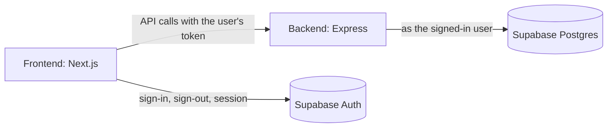

# Habit Garden: Design

Habit Garden is a habit tracker where every habit is a plant. Logging activities makes the plant grow, and meeting recurring goals keeps it healthy. When a habit ends, the user earns a badge based on how well they did.

This page is the map. The detail lives in the documents below.

---

## Contents

- [1. Where to read](#1-where-to-read)
- [2. How it fits together](#2-how-it-fits-together)
- [3. Rules that cut across layers](#3-rules-that-cut-across-layers)
- [4. Deployment](#4-deployment)
- [5. Shared habits (planned)](#5-shared-habits-planned)
- [6. Out of scope](#6-out-of-scope)

---

## 1. Where to read

| Document | Read it for |
| --- | --- |
| [frontend/screens.md](frontend/screens.md) | What each screen shows and does |
| [frontend/design.md](frontend/design.md) | How it looks and how the frontend is built |
| [backend/design.md](backend/design.md) | Endpoints, request flow, and the rules behind every number |
| [database/design.md](database/design.md) | Tables, access control, migrations |
| [frontend/plant-generation.md](frontend/plant-generation.md) | How plants are drawn |
| [dev/](dev) | How we work: branches, PRs, issues |

---

## 2. How it fits together

| Part | Owns |
| --- | --- |
| **Frontend** | Screens and forms. Sends the user's token with every API call |
| **Backend** | Validating requests, the rules, and every calculation |
| **Database** | Stored data and who may touch it |

---

## 3. Rules that cut across layers

- **The frontend only talks to the backend.** The only direct Supabase use is Supabase Auth: sign-in, sign-out and the session.
- **The backend acts as the signed-in user.** No valid token gets 401. There is no admin key.
- **Store facts, compute stats.** Only habits and logs are stored. Progress, streaks, health, growth and badges are calculated by the backend when shown.
- **One timezone per user,** stored on the profile. "Today" and period boundaries use it.
- **Accountability comes before flexibility.** A habit is a commitment, so it cannot be edited after it is created. Letting users keep reshaping a habit would stop holding them to it. To change one, delete it and create a new one.
- **One owner per rule.** If a detail has a document above, link to it instead of copying it here.

---

## 4. Deployment

Not decided yet. The current proposal is one Render service where the Express server serves both the API and the built frontend. That needs the frontend built as a static export. Render's free tier sleeps after 15 minutes without traffic, so the first request after a pause is slow.

Whatever the host, update the Google and Supabase redirect URLs to the deployed address.

---

## 5. Shared habits (planned)

A shared habit is one goal that several people follow together. It is planned for Week 5 and is not built yet.

- **One owner, invited members.** The creator owns the habit and invites others with a private code, shared as a link such as `/join/[code]`. Nobody can join after the start date, and the owner can cap the number of members.
- **Same goal for everyone.** The target, start date and duration are the same for every member.
- **Each member logs for themselves.** Each person keeps their own logs and streak, and can change only their own logs.
- **One shared plant.** Everyone sees the same plant. It grows with the average of the members' progress, and its health follows the average of their health.
- **Names and summaries only.** Members see each other's names and progress summaries, never the exact logs.
- **Editing is still not allowed,** with one exception: the owner can edit a shared habit before it starts. Once someone else has joined, the goal and dates lock.

The tables, access rules and functions are in [the database design](database/design.md#8-shared-habits-planned). The endpoints and the rules behind the group numbers are in [the backend design](backend/design.md#66-shared-habits-planned). The screens are in [the screens](frontend/screens.md#8-shared-habits-planned).

---

## 6. Out of scope

Indefinite habits, reduction habits, reminders, advanced analytics, chat between members and public profiles.