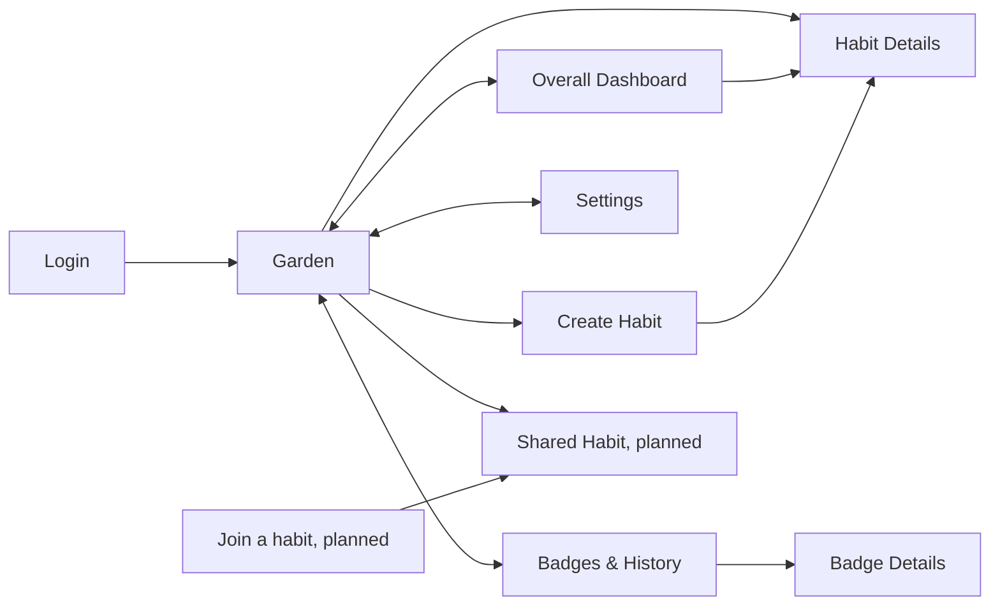

# Habit Garden: Screens

What each screen shows and does. For the rules behind the numbers, see [the backend design](../backend/design.md#8-calculation-rules). For how the screens look, see [the frontend design](design.md). For the big picture, see [design.md](../design.md).

Screens 1 to 7 are for personal habits. Shared habits are planned and described in [section 8](#8-shared-habits-planned).

---

## Contents

- [Screens](#screens)
  - [1. Login](#1-login)
  - [2. Garden (home)](#2-garden-home)
  - [3. Overall Dashboard](#3-overall-dashboard)
  - [4. Habit Details](#4-habit-details)
  - [5. Create Habit](#5-create-habit)
  - [6. Badges and Habit History](#6-badges-and-habit-history)
  - [7. Settings](#7-settings)
  - [8. Shared habits (planned)](#8-shared-habits-planned)

---
## Screens

Every main screen links to the others through the navigation bar.

### 1 Login

- The words take the left third: app name and logo, a title, a short description, and **Sign in with Google**.
- The right two thirds show eight terracotta pots on light wood shelves, on a sage wall. See [login-wall.md](login-wall.md).
- The screen follows the app's light or dark theme. The pots keep their size and fewer of them show as the screen narrows. Below 39rem the wall is one shelf above the words.
- A profile is created automatically on first sign-in.
- After login, users land on the Garden (empty for new users).
- Every other page requires a session. Sessions persist across refreshes until logout or expiry.

### 2 Garden (home)

Every habit is a potted plant on a wall of shelves standing on the page itself, with no card around them, in the order the habits were made. The pots and shelves are the login wall's, 1.5 times as big on desktop, with the pots a little lower on the board and further apart. On narrow screens, each single-column shelf and its plant scale together to fit the available width, keeping the pot centered and the whole shelf visible. At most three pots stand on a shelf (two or one when the screen is narrower), and more habits just add shelves. The shelves use the full measure ([Page width](design.md#7-layout)): the whole width of the screen, with half the side padding the other screens have, and each board runs further at both ends so half of the space left beside it is used. The last active slot is an empty pot that opens Create Habit. Finished habits are on their own shelves under a **Completed garden** heading beneath the active ones, for now (#252 will add the badge marker). The shelf drawing is shared with the login wall (`components/shelf/`), and the Garden's code is in `views/garden/`.

- **At rest:** only the plant, at its real stage and health. The name is not shown: it is in the plant button's label for screen readers and appears on hover.
- **Hover or keyboard focus:** a soft, see-through card opens behind the plant, which stands in front of it, with a faint ring round the plant. The card has the name, what is left ("5 days left this week", "Starts Nov 20" before the start, or "Finished"), a streak pill ("1 week streak", when there is a streak), the period's progress ("Weekly progress", "4/5" and the progress pills) and a line on how far the goal is ("One more to reach your goal!"). It takes no clicks. A touch has no hover.
- **Touch:** a hint above the shelves explains that tapping opens a plant and holding it logs today. The tap panel includes the hover card’s remaining time, progress, streak and goal message, along with its actions. It is a scrollable bottom card on touch devices and small screens, positioned above the bottom navigation and limited to the available viewport height, with a close button and safe-area spacing. The Undo toast appears above the card when present. One pot per shelf is retained at phone widths, including the add pot and completed section.
- **Hold** (one second, with a ring that fills): logs today, with the Undo toast. Scrolling cancels a hold; reduced-motion settings replace the filling animation with a steady ring. Nothing happens for a finished habit.
- **Click or tap:** the peek panel opens beside the plant, out toward the nearer edge of the screen (at the bottom of the screen on a phone). It has the name and goal, remaining time, progress, health, streak and start date, and the buttons **Log today**, **Log another day** (a date dialog limited to the current period, up to today), **Open full page** and **Delete habit** (with its confirmation). It is not a modal: a press anywhere outside it, or Escape, closes it, and a second click on the same plant closes it too.
- **Corners** follow Apple's concentric rule: a corner inside a card has the card's radius minus the space between them, and the card's corners are the continuous "squircle" curve where the browser supports it.
- **Undo** toast after logging. Logging is off for finished habits. There is no edit action, because habits cannot be edited.
- **Empty state:** an empty garden prompting the user to create their first habit.
- **Nav:** Overall Dashboard, Badges, Settings, Add Habit.

### 3 Overall Dashboard

The Dashboard is a habit list with a summary above it. Everything comes from one call, `GET /dashboard` ([6.5](../backend/design.md#65-dashboard)). It refreshes every 60 seconds. The numbers are calculated by the backend, and the page only formats them.

**Summary.** Three cards:

| Card | Shows | Rule |
| --- | --- | --- |
| Active habits | The count, with a note that habits that have not started yet are included | |
| Overall consistency | A percentage, or "—" with "Available after your first completed period." until a habit has finished a period | [8.5](../backend/design.md#85-overall-consistency) |
| Best current streak | The longest streak in periods, with the habit's name as a link. "—" and "Meet a goal to start a streak." when no habit has a streak | [8.6](../backend/design.md#86-streaks) |

**A little attention.** The habits whose plant is not healthy, wilted first, each as a link to its Details page with a neutral label ("Wilted", "Slightly wilted"). A habit whose last period was missed is always here, because a miss makes the plant at least slightly wilted ([8.8](../backend/design.md#88-plant-health)). With none, a message says nothing needs extra attention.

**Current streaks** (the habit list). One row for each active habit, longest streak first. A row has:

- The habit's name, linking to Habit Details.
- "Not started yet" under the name before the start date.
- The streak in periods ("3 periods", since the period can be days, weeks or months). The row of the best streak has a highlight and a "Best streak" label.

There is no per-row period progress, remaining time or calendar. Those are on Habit Details.

**Finished habits.** Expired habits, most recently ended first. Each row has the name (a link to Habit Details), the end date, a badge label (Gold, Silver or Bronze badge, or "No badge"), the final progress and the final consistency. A habit under 60% of its target has no badge. It has a dashed, muted look and a short encouraging note, and a badge has a solid accent. With none, a message says final results will appear here.

**States.**

- **New user:** with no active habits, "Current streaks" is replaced by a card with a **Create a habit** link. If there are finished habits it reads "No active habits".
- **Loading:** "Loading your dashboard…".
- **Error:** "Couldn't load your dashboard" with **Try again**. A 401 shows "Sign in to see your dashboard" with **Sign in again**.
- **After creating a personal habit,** Create Habit redirects here and the summary refreshes (#170).

The Badges screen ([6](#6-badges-and-habit-history)) is still planned and will hold the full badge and history view.

- **Nav:** My Garden, Badges, Settings.

### 4 Habit Details

A header and five soft cards, in a grid that fits one laptop screen (one column on a phone). The page uses the wide measure, with less side padding than other screens ([Page width](design.md#7-layout)). On a phone the cards stack (plant, this week, activity, overall, activity log), the calendar's squares and gaps get smaller, and the page keeps clear of the notch above and the bottom bar below. The three figures in a card stack only when the card itself is narrow. Everything comes from `GET /habits/:id`.

**Header:** a "← Garden" pill, the habit's name as the title, its description if it has one (two lines at most) and **Delete**.

**Plant card:** the plant alone at its real stage ([8.7](../backend/design.md#87-plant-growth)) and health ([8.8](../backend/design.md#88-plant-health)), with a pill under it: plant type, level and the health word.

**"This week" card** (named for the period: Today, This week, This month, or "This period" for a goal every few days, weeks or months). Everything about how the habit is going:

| Shows | Rule |
| --- | --- |
| Progress bar with the count (e.g., 2/3) and how far the goal is | [8.2](../backend/design.md#82-current-period-progress) |
| Overall progress, as a ring | [8.3](../backend/design.md#83-overall-progress) |
| Consistency | [8.4](../backend/design.md#84-consistency) |
| Current streak | [8.6](../backend/design.md#86-streaks) |

The three figures are in one row, and stack only when the card itself is narrow. Under them are **Log today** and **Log date**.

**Activity card:** a month calendar of round day cells. A day with a log is filled green, with "×n" for more than one. Days of the current period that have logs are buttons: one opens a dialog listing that day's logs, each with **Remove**. Earlier periods are locked. The arrows move between months. Behind the days, a soft band joins each period (one piece in each calendar row): a light green once its goal was met, grey if it was missed, a darker green for the current period, and nearly none for periods yet to come. Days outside the habit's run (before it starts, and from its end) have no fill, only an outline. The card is as tall as the column beside it.

**Overall card** (under the calendar, on the right): three figures in one row.

- **Goal:** "3×", every week, from Nov 7.
- **Period:** "2 of 3" (just "2" for a habit with no end) and how many periods are done.
- **Days left:** the days left in the current period as the big number, with the period's dates ("Nov 14 – Nov 20") and when the whole habit ends ("Habit ends Nov 20", or "No end date") under it. Before the start it counts the days until it starts, and after the end it says "Done".

**Activity log card** (under Overall): the days that have activity, newest first, with the count for each ("Today", "Nov 8, 2026"). The latest four show, and "Show all" lists the rest. A day of the current period has a minus button that takes one activity off that day (the latest one), with the same toast as removing from the calendar. Earlier periods are locked and have no button.

**Actions:**

- **Log today.** One press logs today in the profile's time zone. Disabled once the habit has finished, while a save is running, and until today's date is known.
- **Log date.** Opens the same dialog as the Garden's "Choose date": any day from the period's start (or today, before the start) up to today.
- **Undo** toast for about 5 seconds after logging, as in the Garden. Saving refetches the habit, so the whole page shows the saved state. Nothing in the cards changes size while a save runs.
- **Remove a log** from the current period, from the calendar's dialog or with the minus button in the activity log. Earlier periods have no remove action.
- **No editing.** A habit cannot be changed after it is created, so the name, description, plant, goal and duration are all fixed. To change one, delete it and create a new one.
- **Delete habit** (with confirmation). The outlined **Delete** button in the header opens a dialog that names the habit and says it can't be undone. Confirming calls `DELETE /habits/:id`, removes the habit and its logs, and goes back to the Garden. If the habit is already gone it counts as deleted. If deleting fails, the dialog stays open with an error. The code is `components/DeleteHabit.tsx`.

### 5 Create Habit

The page uses the medium measure ([Page width](design.md#7-layout)); the page shell supplies its padding.

| Field | Details |
| --- | --- |
| Name | Required, 1–100 characters |
| Description | Optional, up to 500 characters |
| Goal | Target count per period (1–50) + recurring period: interval (1–365) and unit (days, weeks, or months). E.g., 3 times every 1 week. |
| Duration | Number of periods (1–52, required). The calculated end date is shown. |
| Start date | Today or later. Personal habits default to today and omit it from the request, so the backend uses the profile timezone. Shared habits default to tomorrow in the saved profile timezone; selecting today shows a warning because nobody else can join. A past date is rejected. |
| Plant | Choose one of three plant types (pothos, peace lily, pilea), with a preview. Plants start at stage 1. |

- **Goal preview:** a sentence summarizing the setup, e.g., "Go to the gym 3 times every week for 4 weeks."
- **Confirm step:** before saving, a summary of the goal that says it can't be edited later. To fix a mistake, delete the habit and create it again.
- **Validation errors** are shown inline. If saving fails, an error message is shown.
- **After creation:** redirect to `/dashboard`, where the newly saved habit appears. **Cancel** returns to the Garden.

### 6 Badges and Habit History

The Badges page (`/badges`, `views/Badges.tsx`) is laid out the way osu! lays out its medals: a count, then groups of compact medal grids with no text. It reads the badge book from `GET /me/badges` (`lib/badges.ts`), with a loading line, and an error card with a retry, like the Dashboard. The backend sends no art, so `views/badges/badgeIcons.ts` maps each badge id to an icon, with a fallback for unknown ids. The style guide and tests use `views/badges/sampleBadgeBook.ts`, sample data in the same shape.

**Earning a badge.** `components/BadgeNotifier.tsx` sits in the signed-in layout. Logging, creating a habit and saving the display name push the `new_badges` from their response to it, and on load it asks `GET /me/badges/unseen` for badges earned while the app was closed. Badges show one at a time. Bronze and Silver get a toast with "View badges", raised above any Undo toast. Gold, Platinum and secret badges get a dialog with the large medal. Each one is marked seen (`POST /me/badges/seen`) when it is shown. The achievement ideas are in [badges-ideas.md](../badges-ideas.md) and the medals are in the style guide (`/style-guide`, "Badge medals" and "Badges page").

- **Summary card:** "20 of 73 earned" and the earned count for each tier (Bronze, Silver, Gold, Platinum). The total counts only badges the user can see, so it grows when a secret badge is found.
- **Hide locked:** a toggle that drops the locked badges. Earned and in-progress badges always show.
- **Groups:** Getting started, Logging milestones, Finishing habits, Streaks, Garden and plants, Comebacks, Hard challenges, Badge collector, and Secret badges. Each has a rule above it, a small heading with its earned count ("5/8"), and a compact grid.
- **Slots:** only the badge, with no text. Earned badges are solid medals, in-progress badges are a ring that fills with the tier color, and locked badges are muted with a lock. Hover or keyboard focus shows a small card with the name, tier, rule and status. Click or tap opens a dialog with the large medal, the rule, the date or progress, and **Previous badge** and **Next badge** buttons. Touch screens have no hover card, so a tap opens the dialog.
- **Secret badges:** never shown as locked or in progress, and never counted ahead of time. The Secret group only exists once one is earned, and has pink starburst medals. Earned badges are permanent.
- **Badges | History switch:** two links under the title, styled as a segmented control, with `aria-current` on the current one. The Badges nav item stays current on `/history`.
- **Habit history (`/history`, `views/History.tsx`, #254):** every finished habit, including those without a badge, from `GET /me/history`. A summary card (how many finished, the count per level, activities logged and the average final progress), level filter buttons with counts and a sort (newest, oldest, best result). Newest and oldest group the rows under month headings; best is one list. Each row has the plant as it ended, the name, the level pill (dashed for no badge), the goal and dates, and the final progress, periods met, activities and best streak; the whole row opens Habit Details. 20 load at a time with **Show more**. The filter and sort are in the URL. Empty, loading, error and no-match states are covered by tests. The plan is [habit-history-plan.md](habit-history-plan.md).
- **Empty state:** every achievement is listed as locked.
- **Nav:** Overall Dashboard, My Garden, Settings.

### 7 Settings

The current `/settings` page implements the timezone field (saved through
`PATCH /me`) and an Account section with profile details (#259), Sign out and Delete account. Signed-in pages initialize
an empty profile timezone from the browser (UTC if detection is unavailable)
before allowing habit actions. An existing saved timezone is never replaced
automatically. Profile setup failures offer **Try again** and **Sign in again** (#187). An explicit retry keeps the recovery screen visible with a disabled **Trying again…** button. **Sign in again** calls `signOut()` so the user can start a fresh session. A 401 still shows **Sign in to continue** with only **Sign in again**.

- **Profile (#259):** shows the email and Google profile photo, with a default picture if none is available or loading fails. The display name is editable through `PATCH /me` with only `display_name` in the body. Surrounding spaces are trimmed; empty names and names longer than 50 characters are rejected without a request. Failed saves keep the draft, and success updates the cached profile and invalidates the caller's shared habit/invite summaries. Name and timezone saves share a per-account queue so their full-profile responses cannot overwrite each other's edits.
- **Timezone:** defaults to the browser's on first sign-in, and can be changed here.
- **Appearance:** choose Light or Dark. The choice applies immediately and is saved in this browser; without a saved choice, the app starts with the system preference. The accessible controls are in a separate Appearance section.
- **Sign out**, under Account, with the signed-in email above it. It is no longer at the bottom of the Garden. **Delete account**, under Account: the button opens a dialog that lists what is deleted (habits, activity logs, badges) and asks the user to type `DELETE`. It then calls `DELETE /me`, signs the user out and the signed-in layout sends them to the login page. If deleting fails, an error shows and the user stays signed in. The code is in `views/settings/AccountSection.tsx`.
- **Nav:** Overall Dashboard, My Garden, Badges.

### 8 Shared habits (planned)

Creation and invite copying (#274), joining (#275), shared habit details (#276), logging (#277), Garden cards (#279), and owner/member actions (#278) are implemented. Editing the shared habit's fields remains planned. The rules are in [the backend design](../backend/design.md#66-shared-habits-planned) and the tables are in [the database design](../database/design.md#8-shared-habits-planned).

**Create (#274).** Create Habit (screen 5) has a choice between "Just me" and "With friends". With friends adds **Join by**, between today and the start date (default: the day before the start, or today when starting today), and **Max members**, from 2 to 50 including the owner. Shared creation uses the saved profile timezone and defaults to the next local date. It explains that joining closes after the deadline or as soon as any member reaches the start date in their saved membership timezone. Selecting today displays a warning in the form and confirmation. The confirm step says the goal and start date lock once a friend joins, and that after the start nothing can be edited. After saving, the owner sees a copyable invite link only after the server confirms it is available and has room; unavailable links are hidden and failed checks can be retried. Availability is rechecked periodically while the screen is open. Personal creation still redirects to the dashboard.

**Invite.** Invite links use `/join?code=...`, with the deployment base path included, to support the static GitHub Pages export (the same approach as personal habit details). The shared habit page shows the link with a copy button; owners also have **Get a new link** and **Close joining** in Manage shared habit. Joining also closes after the join by date or when any member reaches the start date in their saved timezone (#272).

**Join (`/join?code=...`, #275).** Signing in is required before fetching the preview, and Google sign-in returns here with the invite code. The page shows the name, the goal as a sentence, the start date, the owner's name and how many places are left. It says that other members will see your display name. A wrong, closed or expired link shows one message that does not say which. A full habit and an ended joining window each have their own message, including when the state changes between preview and Join. Network failures offer a retry, and expired sessions offer sign-in again. Successful joining shows a confirmation and a **View shared habit** link (#276); creation has the same link. Rejoining uses the backend's idempotent operation, which does not add duplicate membership. The preview does not currently expose an already-member flag or habit ID, so it cannot automatically skip this page for existing members.

**Shared habit page (`/shared-habit?id=...`, #276, redesigned in #337).** Uses `GET /shared-habits/:id`, with account-specific query keys and a 60-second refresh. Unavailable or inaccessible habits show a generic error, network failures can be retried, and a background network failure keeps the last loaded values visible. A refreshed 401/404 hides cached details. Group dates and state come from the backend.

The page has the same header and cards as Habit Details (screen 4), reusing the components in `views/habit/`. The member's own stats (`own_stats`, in the membership timezone given by `own_today`) stand where a personal habit's stats do, so the calendar, log and figures show the member's own days. The group's `stats` are used only where the text below says so. The layout, corners, phone and wide-screen behavior are screen 4's.

- **Header:** the "← Garden" pill, the name and the description. There is no Delete button, because members cannot delete a shared habit.
- **Plant card:** the one shared plant, at the group's growth stage and health.
- **"This week" card:** the group's average activities per member as the main bar and count, which can be fractional (shown to two decimals at most, never rounded in the API). Under it a smaller bar shows the member's own count. The three-figure row is the member's own overall progress ring, consistency and streak. **Log today** and **Log date** log the member's own activity, as in screen 4. Logging is disabled before the start date (shared habits cannot be logged before they start, unlike personal ones), once the member's habit has finished, and while a save runs.
- **Activity card and activity log (#277):** the member's own days, with the same bands, outlines, day dialog and minus buttons as screen 4. Locked periods and other members have no remove controls. Bounds and expiry use `own_today` and `own_stats`, not the group date or the profile date.
- **Overall card:** the goal, the period and the days left, from the member's own dates, with **Members** under them: how many members out of the maximum.
- **Logging (#277):** the Undo toast is the one in screen 4. An add or remove response immediately updates the group stats and plant, the member's stats and days, and the member's row; the full detail is then refetched. A failed refetch cannot turn a saved log into an apparent failed save.
- **Members card** (below the grid, with Invite): a row for every member with name, overall progress, current period count, streak and health. It is a table on a wide screen and a list on a phone. Exact logs are never shown. Before the start it is titled "Who has joined".
- **Invite card:** the join deadline, the invite link and **Copy invite link**, with a manual-copy fallback, or "Joining is closed" once the link is closed. Every current member can copy the link. Replacing it updates this card; closing joining removes the link.
- **Manage shared habit (#278):** owners choose another member and then **Remove member** or **Transfer ownership**. They also have **Get a new link**, **Close joining** (while a code exists), and **Delete shared habit**. Regular members see only **Leave habit**. Every action opens a named confirmation before sending a request. Leaving/removal keeps past logs but excludes the departed member from group averages; deletion removes the habit and all members' activity. Transfer keeps the old owner as a regular member, with Leave now available; a sole owner must invite someone before transferring, or delete the habit instead. Editing the habit's fields remains planned.
- **Management limits and feedback:** invite changes are disabled once the caller or group has started. The server also checks other members' private membership timezones and any permanent start lock; a 400 explains that the invite can no longer change. Replacing a link invalidates the old one; closing can be reversed with a new link only while the backend allows invite management. Pending confirmations block duplicate requests and dismissal. Failures keep the confirmation open with retry or sign-in again; stale permissions/membership trigger a refresh. Successful changes refresh the account's shared queries and invite previews; transfer and invite changes update confirmed cache values immediately, while removal refetches backend group calculations. Leave/delete discard cached detail and return to the Garden.

**Garden (#279).** Personal shelves (including their completed section) come first; a separate **Shared habits** card grid follows. Shared cards are oldest first, with the ID as a tie-breaker. Each shows the group's plant stage/health, a "Shared" marker with member count, and the caller's own integer period count (not the fractional group average). The name and plant link to `/shared-habit?id=...`; logging and management stay on Details. Future and finished habits show their status. Both lists paginate independently. A shared-list loading/error state does not hide personal shelves, and a personal-list failure does not hide shared cards. The all-empty message appears only after both lists are empty; shared-only accounts never get a false empty Garden. Queries are scoped per account, shared summaries refresh every 60 seconds, and shared creation/join/logging invalidate the shared query prefix. List responses contain the card summaries without detail requests.

**Badges.** Each member earns their own badge from their own results. Group badges are not decided yet.

**Nav:** the same as the other screens.
