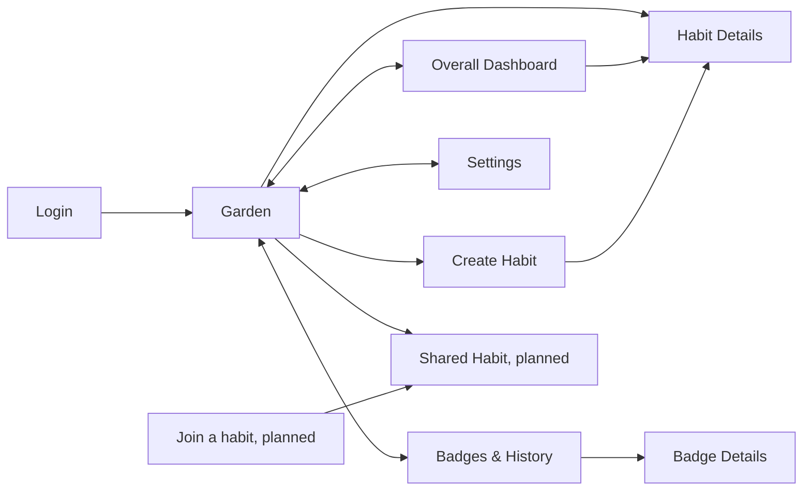

# Habit Garden: Screens

What each screen shows and does. For the rules behind the numbers, see [the backend design](../backend/design.md#8-calculation-rules). For how the screens look, see [the frontend design](design.md). For the big picture, see [design.md](../design.md).

Screens 1 to 7 are for personal habits. Shared habits are planned and described in [section 8](#8-shared-habits-planned).

---

## Contents

- [Screens](#screens)
  - [1. Login](#1-login)
  - [2. Garden (home)](#2-garden-home)
  - [3. Overall Dashboard](#3-overall-dashboard)
  - [4. Habit Details](#4-habit-details)
  - [5. Create Habit](#5-create-habit)
  - [6. Badges and Habit History](#6-badges-and-habit-history)
  - [7. Settings](#7-settings)
  - [8. Shared habits (planned)](#8-shared-habits-planned)

---
## Screens

Every main screen links to the others through the navigation bar.

### 1 Login

- App name, logo, short description, and **Sign in with Google**.
- A profile is created automatically on first sign-in.
- After login, users land on the Garden (empty for new users).
- Every other page requires a session. Sessions persist across refreshes until logout or expiry.

### 2 Garden (home)

All active habits shown as potted plants in a grid.

- Each plant shows its **name**, a **current period progress bar**, and its **appearance** (growth stage + health).
- **Click** a plant to open Habit Details.
- **Press and hold** a plant to log an activity for today.
- Each plant's options menu: **Log activity**, **View details**. There is no edit action, because habits cannot be edited.
- **Empty state:** an empty garden prompting the user to create their first habit.
- **Nav:** Overall Dashboard, Badges, Settings, Add Habit.

### 3 Overall Dashboard

The current `/dashboard` page uses `GET /dashboard` to show active habit count,
overall consistency (a dash while unavailable), and current streaks per habit.
The backend's best streak is highlighted (#213). Streaks are labelled in periods,
and future habits show "Not started yet". New users see a friendly empty state
with a create-habit link. Successful creation redirects here and refreshes the
summary (#170). "A little attention" lists the backend's `needs_attention`
habits with neutral health labels and links to their details; an empty list
shows encouragement (#214). This includes missed last periods through the
backend's existing health rule. "Finished habits" shows expired habits from the
backend's `finished` list with the final badge, progress and consistency (#215).
No-badge results (under 60%) have a distinct dashed, muted treatment and an
explicit label; awarded results have a solid accent and badge-level label.
An empty history shows encouragement. The full badges page is still planned;
the remaining planned presentation is described below.

A summary of activity across all active habits.

- **Active habits:** count of habits currently tracked.
- **Overall consistency:** average consistency across active habits ([rule 8.5](../backend/design.md#85-overall-consistency)). Shows "—" if no habit has finished a period yet.
- **Habit list.** Each row shows:
  - Habit name
  - Current period progress (e.g., 2/3 this week)
  - Streak (e.g., 3 weeks)
  - Remaining duration
  - Mini calendar: green on days with logs, gray otherwise. Missed goals are shown per period, not per day.
- Clicking a habit opens Habit Details.
- **Nav:** My Garden, Badges, Settings.

### 4 Habit Details

**Info:** name, description, plant type, goal (e.g., 3 times every week), start and end dates, remaining duration.

**Progress:**

| Metric | Shows | Rule |
| --- | --- | --- |
| Current period | Count toward target (e.g., 2/3), progress bar with tick marks | [8.2](../backend/design.md#82-current-period-progress) |
| Overall progress | % of total target, capped at 100% (circular indicator) | [8.3](../backend/design.md#83-overall-progress) |
| Consistency | % of completed periods where the target was met | [8.4](../backend/design.md#84-consistency) |
| Current streak | Consecutive successful periods, counting the current one once its target is met | [8.6](../backend/design.md#86-streaks) |

**Activity history:** calendar of logged dates, plus a per-period breakdown with each completed period's count and whether its goal was met. Logs in the current period show a delete button.

**Plant:** growth stage ([8.7](../backend/design.md#87-plant-growth)) combined with health ([8.8](../backend/design.md#88-plant-health)).

**Actions:**

- **Log activity.** A date picker defaults to today and allows any date in the current period up to today.
- **Undo** toast for about 5 seconds after logging.
- **Delete a log** from the current period.
- **No editing.** A habit cannot be changed after it is created, so the name, description, plant, goal and duration are all fixed. To change one, delete it and create a new one.
- **Delete habit** (with confirmation). Removes the habit and its logs.

### 5 Create Habit

| Field | Details |
| --- | --- |
| Name | Required, 1–100 characters |
| Description | Optional, up to 500 characters |
| Goal | Target count per period (1–50) + recurring period: interval (1–365) and unit (days, weeks, or months). E.g., 3 times every 1 week. |
| Duration | Number of periods (1–52, required). The calculated end date is shown. |
| Start date | Today or later. Left at the default, it is omitted from the request and the backend uses today in the user's profile timezone (the confirm step shows "Today"). A past date is rejected. |
| Plant | Choose one of three plant types (pothos, peace lily, pilea), with a preview. Plants start at stage 1. |

- **Goal preview:** a sentence summarizing the setup, e.g., "Go to the gym 3 times every week for 4 weeks."
- **Confirm step:** before saving, a summary of the goal that says it can't be edited later. To fix a mistake, delete the habit and create it again.
- **Validation errors** are shown inline. If saving fails, an error message is shown.
- **After creation:** redirect to `/dashboard`, where the newly saved habit appears. **Cancel** returns to the Garden.

### 6 Badges and Habit History

- **Badge grid:** at most one badge per habit. Each shows the habit name, plant illustration, level (Bronze/Silver/Gold), and completion date.
- **Badge details:** goal and duration, final overall progress and consistency, total activities, final plant stage and health, level, completion date.
- **Habit history:** all expired habits, including those without badges, with final stats and activity history.
- **Empty state:** encouragement to keep growing habits.
- **Nav:** Overall Dashboard, My Garden, Settings.

### 7 Settings

The current `/settings` page implements the timezone field and saves through
`PATCH /me`. The other settings below are planned. Signed-in pages initialize
an empty profile timezone from the browser (UTC if detection is unavailable)
before allowing habit actions. An existing saved timezone is never replaced
automatically. Profile setup failures show a retry action.

- Username, email, and profile picture (from Google). Display name is editable, and saved through the backend.
- **Timezone:** defaults to the browser's on first sign-in, and can be changed here.
- Light/dark mode toggle, saved in the browser.
- Log out. Delete account, under Account, with a confirmation that lists what is deleted (habits, activity logs, badges).
- **Nav:** Overall Dashboard, My Garden, Badges.

### 8 Shared habits (planned)

Not built yet. The rules are in [the backend design](../backend/design.md#66-shared-habits-planned) and the tables are in [the database design](../database/design.md#8-shared-habits-planned).

**Create.** Create Habit (screen 5) gets a choice between "Just me" and "With friends". With friends adds two fields: **Join by**, a date on or before the start date (default: the day before), and **Max members**, from 2 up to the system limit. The start date can be today or later. The confirm step says the goal and start date lock once a friend joins, and that after the start nothing can be edited. After saving, the owner sees the invite.

**Invite.** The shared habit page shows the link (`/join/[code]`) with a copy button, **Get a new link**, and **Close joining**. Joining also closes by itself after the join by date.

**Join (`/join/[code]`).** Signing in is required, and signing in returns here. The page shows the name, the goal as a sentence, the start date, the owner's name and how many places are left. It says that other members will see your display name. A wrong, closed or expired link shows one message that does not say which. A full habit and an ended joining window each have their own message. Someone who is already a member goes straight to the habit.

**Shared habit page.**
- **Info:** name, description, goal, start and end dates, remaining duration.
- **Plant:** the one shared plant, at the group's growth stage and health.
- **Progress:** the group progress (the average), your own progress (current period count with ticks, overall progress, consistency and streak), and a row for every member with their name, overall progress, current period count, streak and health. Exact logs are never shown.
- **Activity:** your own calendar and per-period history. **Log activity** has a date picker as in screen 4, with Undo, and you can delete your own logs in the current period. Before the start date, the page says "Starts on ...", shows who has joined, and nobody can log.
- **Owner actions:** edit before the start (within the rules in the backend design), remove a member, transfer ownership, get a new link or close joining, and delete the habit with a confirmation.
- **Member actions:** leave, with a confirmation that says your past logs stay but you are no longer counted. The owner transfers ownership before leaving.

**Garden.** A shared habit is one card with the group plant, a "shared" marker with the member count, and your own current period bar. How shared and personal habits are ordered is not decided.

**Badges.** Each member earns their own badge from their own results. Group badges are not decided yet.

**Nav:** the same as the other screens.
