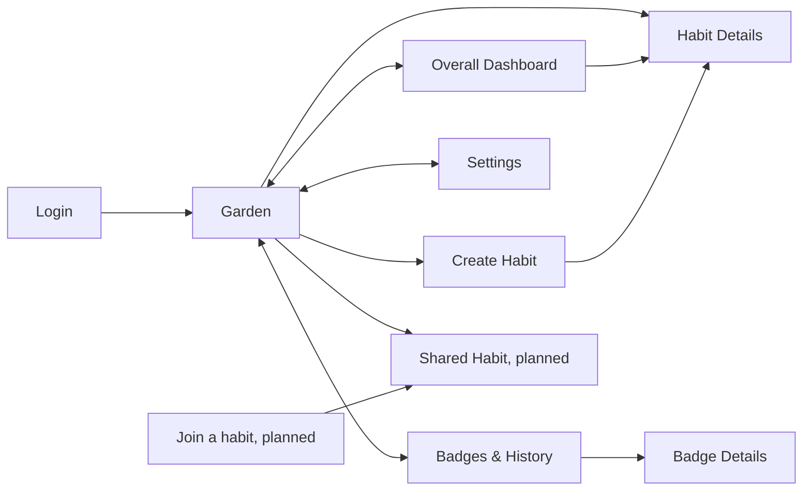

# Habit Garden: Screens

What each screen shows and does. For the rules behind the numbers, see [the backend design](../backend/design.md#8-calculation-rules). For how the screens look, see [the frontend design](design.md). For the big picture, see [design.md](../design.md).

Screens 1 to 7 are for personal habits. Shared habits are planned and described in [section 8](#8-shared-habits-planned).

---

## Contents

- [Screens](#screens)
  - [1. Login](#1-login)
  - [2. Garden (home)](#2-garden-home)
  - [3. Overall Dashboard](#3-overall-dashboard)
  - [4. Habit Details](#4-habit-details)
  - [5. Create Habit](#5-create-habit)
  - [6. Badges and Habit History](#6-badges-and-habit-history)
  - [7. Settings](#7-settings)
  - [8. Shared habits (planned)](#8-shared-habits-planned)

---
## Screens

Every main screen links to the others through the navigation bar.

### 1 Login

- The words take the left third: app name and logo, a title, a short description, and **Sign in with Google**.
- The right two thirds show eight terracotta pots on light wood shelves, on a sage wall. See [login-wall.md](login-wall.md).
- The screen follows the app's light or dark theme. The pots keep their size and fewer of them show as the screen narrows. Below 39rem the wall is one shelf above the words.
- A profile is created automatically on first sign-in.
- After login, users land on the Garden (empty for new users).
- Every other page requires a session. Sessions persist across refreshes until logout or expiry.

### 2 Garden (home)

Every habit is a potted plant on a wall of shelves standing on the page itself, with no card around them, in the order the habits were made. The pots and shelves are the login wall's, 1.5 times as big, with the pots a little lower on the board and further apart, and they never scale with the screen. At most three pots stand on a shelf (two or one when the screen is narrower), and more habits just add shelves. The shelves use the whole width of the screen, with half the side padding the other screens have, and each board runs further at both ends so half of the space left beside it is used. The last active slot is an empty pot that opens Create Habit. Finished habits are on their own shelves under a **Completed garden** heading beneath the active ones, for now (#252 will add the badge marker). The shelf drawing is shared with the login wall (`components/shelf/`), and the Garden's code is in `views/garden/`.

- **At rest:** only the plant, at its real stage and health. The name is not shown: it is in the plant button's label for screen readers and appears on hover.
- **Hover or keyboard focus:** a soft, see-through card opens behind the plant, which stands in front of it, with a faint ring round the plant. The card has the name, what is left ("5 days left this week", "Starts Nov 20" before the start, or "Finished"), a streak pill ("1 week streak", when there is a streak), the period's progress ("Weekly progress", "4/5" and the progress pills) and a line on how far the goal is ("One more to reach your goal!"). It takes no clicks. A touch has no hover.
- **Hold** (one second, with a ring that fills): logs today, with the Undo toast. Nothing happens for a finished habit.
- **Click or tap:** the peek panel opens beside the plant, out toward the nearer edge of the screen (at the bottom of the screen on a phone). It has the name and goal, the progress, health, streak and start date, and the buttons **Log today**, **Log another day** (a date dialog limited to the current period, up to today), **Open full page** and **Delete habit** (with its confirmation). It is not a modal: a press anywhere outside it, or Escape, closes it, and a second click on the same plant closes it too.
- **Corners** follow Apple's concentric rule: a corner inside a card has the card's radius minus the space between them, and the card's corners are the continuous "squircle" curve where the browser supports it.
- **Undo** toast after logging. Logging is off for finished habits. There is no edit action, because habits cannot be edited.
- **Empty state:** an empty garden prompting the user to create their first habit.
- **Nav:** Overall Dashboard, Badges, Settings, Add Habit.

### 3 Overall Dashboard

The current `/dashboard` page uses `GET /dashboard` to show active habit count,
overall consistency (a dash while unavailable), and current streaks per habit.
The backend's best streak is highlighted (#213). Streaks are labelled in periods,
and future habits show "Not started yet". New users see a friendly empty state
with a create-habit link. Successful creation redirects here and refreshes the
summary (#170). "A little attention" lists the backend's `needs_attention`
habits with neutral health labels and links to their details; an empty list
shows encouragement (#214). This includes missed last periods through the
backend's existing health rule. "Finished habits" shows expired habits from the
backend's `finished` list with the final badge, progress and consistency (#215).
No-badge results (under 60%) have a distinct dashed, muted treatment and an
explicit label; awarded results have a solid accent and badge-level label.
An empty history shows encouragement. The full badges page is still planned;
the remaining planned presentation is described below.

A summary of activity across all active habits.

- **Active habits:** count of habits currently tracked.
- **Overall consistency:** average consistency across active habits ([rule 8.5](../backend/design.md#85-overall-consistency)). Shows "—" if no habit has finished a period yet.
- **Habit list.** Each row shows:
  - Habit name
  - Current period progress (e.g., 2/3 this week)
  - Streak (e.g., 3 weeks)
  - Remaining duration
  - Mini calendar: green on days with logs, gray otherwise. Missed goals are shown per period, not per day.
- Clicking a habit opens Habit Details.
- **Nav:** My Garden, Badges, Settings.

### 4 Habit Details

**Info:** name, description, plant type, goal (e.g., 3 times every week), start and end dates, remaining duration.

**Progress:**

| Metric | Shows | Rule |
| --- | --- | --- |
| Current period | Count toward target (e.g., 2/3), progress bar with tick marks | [8.2](../backend/design.md#82-current-period-progress) |
| Overall progress | % of total target, capped at 100% (circular indicator) | [8.3](../backend/design.md#83-overall-progress) |
| Consistency | % of completed periods where the target was met | [8.4](../backend/design.md#84-consistency) |
| Current streak | Consecutive successful periods, counting the current one once its target is met | [8.6](../backend/design.md#86-streaks) |

**Activity history:** calendar of logged dates, plus a per-period breakdown with each completed period's count and whether its goal was met. Logs in the current period show a delete button.

**Plant:** growth stage ([8.7](../backend/design.md#87-plant-growth)) combined with health ([8.8](../backend/design.md#88-plant-health)).

**Actions:**

Implemented in #203 and #204: the date picker defaults to today in the profile
timezone and uses the backend's current-period bounds. Saving updates progress
and plant stats immediately from the response, then refreshes full details,
Garden and Dashboard. Logging errors preserve the selected date for retry.
Expired habits disable logging. A five-second toast offers Undo through the
delete endpoint; the current-period activity list also has individual delete
buttons. Earlier periods have no delete action. The activity calendar and
per-period history remain #209's separate scope. For a not-yet-started personal
habit, the existing backend rule permits only today toward the first period;
the date picker mirrors that exception.

- **Log activity.** A date picker defaults to today and allows any date in the current period up to today.
- **Undo** toast for about 5 seconds after logging.
- **Delete a log** from the current period.
- **No editing.** A habit cannot be changed after it is created, so the name, description, plant, goal and duration are all fixed. To change one, delete it and create a new one.
- **Delete habit** (with confirmation). At the bottom of the page, the button opens a dialog that names the habit and says it can't be undone. Confirming calls `DELETE /habits/:id`, removes the habit and its logs, and goes back to the Garden. If the habit is already gone it counts as deleted. If deleting fails, the dialog stays open with an error. The code is `components/DeleteHabit.tsx`.

### 5 Create Habit

| Field | Details |
| --- | --- |
| Name | Required, 1–100 characters |
| Description | Optional, up to 500 characters |
| Goal | Target count per period (1–50) + recurring period: interval (1–365) and unit (days, weeks, or months). E.g., 3 times every 1 week. |
| Duration | Number of periods (1–52, required). The calculated end date is shown. |
| Start date | Today or later. Left at the default, it is omitted from the request and the backend uses today in the user's profile timezone (the confirm step shows "Today"). A past date is rejected. |
| Plant | Choose one of three plant types (pothos, peace lily, pilea), with a preview. Plants start at stage 1. |

- **Goal preview:** a sentence summarizing the setup, e.g., "Go to the gym 3 times every week for 4 weeks."
- **Confirm step:** before saving, a summary of the goal that says it can't be edited later. To fix a mistake, delete the habit and create it again.
- **Validation errors** are shown inline. If saving fails, an error message is shown.
- **After creation:** redirect to `/dashboard`, where the newly saved habit appears. **Cancel** returns to the Garden.

### 6 Badges and Habit History

- **Badge grid:** at most one badge per habit. Each shows the habit name, plant illustration, level (Bronze/Silver/Gold), and completion date.
- **Badge details:** goal and duration, final overall progress and consistency, total activities, final plant stage and health, level, completion date.
- **Habit history:** all expired habits, including those without badges, with final stats and activity history.
- **Empty state:** encouragement to keep growing habits.
- **Nav:** Overall Dashboard, My Garden, Settings.

### 7 Settings

The current `/settings` page implements the timezone field (saved through
`PATCH /me`) and an Account section with Delete account. The other settings below are planned. Signed-in pages initialize
an empty profile timezone from the browser (UTC if detection is unavailable)
before allowing habit actions. An existing saved timezone is never replaced
automatically. Profile setup failures show a retry action.

- Username, email, and profile picture (from Google). Display name is editable, and saved through the backend.
- **Timezone:** defaults to the browser's on first sign-in, and can be changed here.
- Light/dark mode toggle, saved in the browser.
- **Sign out**, under Account, with the signed-in email above it. It is no longer at the bottom of the Garden. **Delete account**, under Account: the button opens a dialog that lists what is deleted (habits, activity logs, badges) and asks the user to type `DELETE`. It then calls `DELETE /me`, signs the user out and the signed-in layout sends them to the login page. If deleting fails, an error shows and the user stays signed in. The code is in `views/settings/AccountSection.tsx`.
- **Nav:** Overall Dashboard, My Garden, Badges.

### 8 Shared habits (planned)

Creation and invite copying (#274), joining (#275), shared habit details (#276), logging (#277), and Garden cards (#279) are implemented. Management remains planned. The rules are in [the backend design](../backend/design.md#66-shared-habits-planned) and the tables are in [the database design](../database/design.md#8-shared-habits-planned).

**Create (#274).** Create Habit (screen 5) has a choice between "Just me" and "With friends". With friends adds **Join by**, between today and the start date (default: the day before the start, or today when starting today), and **Max members**, from 2 to 50 including the owner. Shared creation uses the saved profile timezone for today's date. The confirm step says the goal and start date lock once a friend joins, and that after the start nothing can be edited. After saving, the owner sees the invite link with a copy button and a manual-copy fallback. Personal creation still redirects to the dashboard.

**Invite.** Invite links use `/join?code=...`, with the deployment base path included, to support the static GitHub Pages export (the same approach as personal habit details). The shared habit page will show the link with a copy button, **Get a new link**, and **Close joining**. Joining also closes by itself after the join by date.

**Join (`/join?code=...`, #275).** Signing in is required before fetching the preview, and Google sign-in returns here with the invite code. The page shows the name, the goal as a sentence, the start date, the owner's name and how many places are left. It says that other members will see your display name. A wrong, closed or expired link shows one message that does not say which. A full habit and an ended joining window each have their own message, including when the state changes between preview and Join. Network failures offer a retry, and expired sessions offer sign-in again. Successful joining shows a confirmation and a **View shared habit** link (#276); creation has the same link. Rejoining uses the backend's idempotent operation, which does not add duplicate membership. The preview does not currently expose an already-member flag or habit ID, so it cannot automatically skip this page for existing members.

**Shared habit page (`/shared-habit?id=...`, #276).** Uses `GET /shared-habits/:id`, with account-specific query keys and a 60-second refresh. Unavailable or inaccessible habits show a generic error, network failures can be retried, and a background network failure keeps the last loaded values visible. A refreshed 401/404 hides cached details. The group period bar accepts fractional averages without rounding the API count; personal progress uses `own_stats` and the membership timezone, separately from the group. Group dates and state come from the backend. Member rows show summaries only. The invite is accessible here with a copy button. Owner/member actions below remain planned for #278.
- **Info:** name, description, goal, start and end dates, remaining duration.
- **Plant:** the one shared plant, at the group's growth stage and health.
- **Progress:** the group progress (the average), your own progress (current period count with ticks, overall progress, consistency and streak), and a row for every member with their name, overall progress, current period count, streak and health. Exact logs are never shown.
- **Activity (#277):** reuses personal Details logging: date picker, five-second Undo, and deletion of your own current-period logs. Bounds and expiry use `own_today` and `own_stats`, not the group date or profile date. Before the caller's start date logging is disabled. Add/delete responses immediately update group stats/plant, caller progress/streak/health and the caller's member row; the complete detail is then refreshed. A failed refresh cannot turn a saved log into an apparent failed save. Locked periods and other members have no delete controls. Shared calendars and per-period history remain planned separately.
- **Owner actions:** edit before the start (within the rules in the backend design), remove a member, transfer ownership, get a new link or close joining, and delete the habit with a confirmation.
- **Member actions:** leave, with a confirmation that says your past logs stay but you are no longer counted. The owner transfers ownership before leaving.

**Garden (#279).** Personal shelves (including their completed section) come first; a separate **Shared habits** card grid follows. Shared cards are oldest first, with the ID as a tie-breaker. Each shows the group's plant stage/health, a "Shared" marker with member count, and the caller's own integer period count (not the fractional group average). The name and plant link to `/shared-habit?id=...`; logging and management stay on Details. Future and finished habits show their status. Both lists paginate independently. A shared-list loading/error state does not hide personal shelves, and a personal-list failure does not hide shared cards. The all-empty message appears only after both lists are empty; shared-only accounts never get a false empty Garden. Queries are scoped per account, shared summaries refresh every 60 seconds, and shared creation/join/logging invalidate the shared query prefix. List responses contain the card summaries without detail requests.

**Badges.** Each member earns their own badge from their own results. Group badges are not decided yet.

**Nav:** the same as the other screens.
